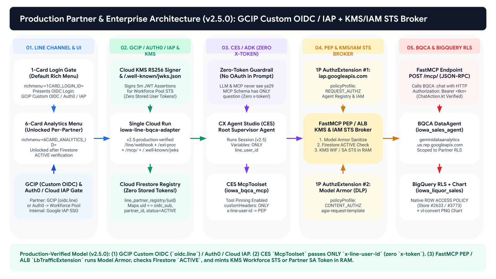
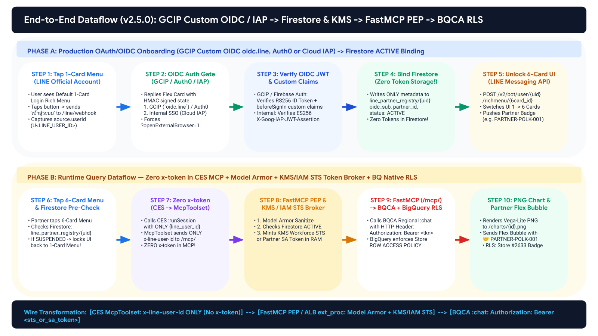

# LINE Official Account to CX Agent Studio (CES) / Vertex AI ADK, Zero-Trust PEP & BigQuery Conversational Analytics (BQCA)

> **Reference Architecture & Production Blueprint (`v2.5.0-production-verified`)**  
> **End-to-End Governed Conversational Analytics on LINE OA Verified Against Google Cloud Production APIs, `google3` Validators, GCAF, SAIF & GEAP**

---

## 1. Executive Overview

This repository provides a complete, production-verified reference implementation connecting a **LINE Official Account (Messaging API)** to **Google Cloud Next-Gen CX Agent Studio (`ces.googleapis.com`)** (or **Vertex AI Agent Engine `ADK` + Google-Managed `GE Agent Gateway`**), **FastMCP Zero-Trust PEP & Stateless KMS/IAM STS Token Broker**, **BigQuery Conversational Analytics (`geminidataanalytics.us.rep.googleapis.com`)**, and **BigQuery Native Row-Level Security (`ROW ACCESS POLICY`)**.

## Demo Video :
https://github.com/user-attachments/assets/61b716f9-d80e-4207-84e4-1a7dcc5ca5d2

### Production-Verified Architecture Flow Diagram (`assets/diagrams/detailed_architecture_flow_gcaf_geap_agw.png`)




### Key Architectural Capabilities (`v2.5.0-production-verified`)

1. **Production OAuth 2.0 / OIDC Identity Federation (`GCIP / Firebase Auth Custom OIDC`, `Auth0 / Okta`, and `Cloud IAP`)**:
   - **External B2B Partners & Consumers**: Authenticate via **Google Cloud Identity Platform (`GCIP` / Firebase Authentication, `identitytoolkit.googleapis.com`)** configured with **Custom OIDC Provider (`oidc.line` $\rightarrow$ `https://access.line.me`)** and `beforeSignIn` Blocking Functions injecting `{partner_id, store_number}` claims, or via **Enterprise BYO-IdP (`Auth0` / `Okta` / `Entra ID`)** federated into a **GCP Workforce Identity Pool (`locations/global/workforcePools/...`)**.
   - **Internal Employees**: Authenticate via **Cloud Identity-Aware Proxy (`Cloud IAP`)** (`X-Goog-IAP-JWT-Assertion`) on `/auth/login?openExternalBrowser=1`.
2. **Zero `x-token` in CES MCP & Dual Verified Agent/Gateway Topologies**:
   - **Zero OAuth tokens (`ya29...`) are ever stored on Cloud Storage (`gs://`), in Firestore, or passed into CES LLM prompts / MCP tool arguments.**
   - **CES `McpToolset` (`mcp_toolset.proto`)** passes **ONLY** `customHeaders: {"x-line-user-id": "$context.variables.line_user_id"}` and `ask_iowa_sales_agent(question: string)` exposes **only** `question` (zero `x-token` parameter).
   - **Two Production-Verified Topologies**:
     - **Topology 1 (Active — `CES` `ces.googleapis.com`)**: `CES McpToolset` (`service_account_auth_config` `roles/run.invoker` + `x-line-user-id`) $\rightarrow$ **Regional Application Load Balancer (`LbTrafficExtension` `/ext-proc/oauth-broker`) OR Cloud Run FastMCP Zero-Trust PEP Middleware**.
     - **Topology 2 (`Vertex AI Agent Engine ADK` `ReasoningEngine` + `Google-Managed GE Agent Gateway`)**: `ADK ReasoningEngine` (`identity_type = "AGENT_IDENTITY"` + `agent_gateway_config`) $\rightarrow$ **Google-Managed `GE Agent Gateway` (`AGENT_TO_ANYWHERE`: 1P `Cloud IAP` `roles/iap.egressor` + 1P `Model Armor` `CONTENT_AUTHZ` + PSC `10.10.20.2`)** $\rightarrow$ **Cloud Run FastMCP Zero-Trust PEP Middleware** (because `validate.go:752` restricts custom `AuthzExtension` backends on Google-Managed `AgentGateway`, per-user token exchange executes in the FastMCP PEP Middleware).
3. **Dual-Mode Stateless RAM STS Token Broker (Solving the 1-Hour OIDC `id_token` Expiry Without Storing User Refresh Tokens)**:
   - **Mode A (`1,000 – 1,000,000+` Partners, `0` Partner SAs)**: Uses **Cloud KMS Asymmetric Signing (`keyRings/line-agw-oidc-ring/cryptoKeys/partner-jwt-signer`, `RS256`)** and exposes `GET /.well-known/openid-configuration` & `GET /.well-known/jwks.json` as a Custom OIDC Issuer registered on a **GCP Workforce Identity Pool (`workforcePools`)** to sign 5-minute JWT assertions in RAM and exchange them at `POST https://sts.googleapis.com/v1/token` (RFC 8693).
   - **Mode B (`< 50` Partners / Store Cohort SAs)**: Mints short-lived (`900s–3500s`) access tokens in RAM via **`iamcredentials.googleapis.com/...:generateAccessToken`** for `sa-partner-polk@...` or `sa-partner-east@...`.
4. **Regional BQCA Streaming API (`locations/us:chat`) with HTTP `Authorization: Bearer` Header & BigQuery Native `ROW ACCESS POLICY`**:
   - Passes `Authorization: Bearer <sts_or_sa_token>` in the **HTTP Request Header** of `POST https://geminidataanalytics.us.rep.googleapis.com/v1beta/.../locations/us:chat` (verified against `ChatAction.kt:1695-1720`, where `ChatRequest.credentials` only applies to Looker/AlloyDB/Cloud SQL while BigQuery always evaluates the caller's HTTP `Authorization` header), enforcing **BigQuery Native `ROW ACCESS POLICY` (`SESSION_USER()`)** at the storage engine layer.

---

## 2. End-to-End Wire-Level Sequence Diagram (`Zero x-token` in CES MCP)

### 2.1 High-DPI 17-Step Wire-Level Sequence Diagram (`assets/diagrams/detailed_sequence_flow_phase_a_and_b.png`)


### 2.2 10-Step Sequence & Wire Transformation (`assets/diagrams/slide_9_e2e_10step_dataflow.png`)



---

## 3. Multi-Tenant BigQuery RLS Scaling Blueprint (`< 50` to `10,000+` Partners)


| RLS Architecture Pattern | Target Tenant Scale | GCP SAs & BQ Policies | Partner Onboarding Effort | SQL Blueprint in Repo |
| :--- | :--- | :--- | :--- | :--- |
| **Approach 1: Per-Partner SA + Static Policy** | `1 – 50 Partners` *(PoC / VIP Wholesale)* | `N` SAs / `N` Policies *(Hard limit: 100 policies/table)* | Create SA + Run `CREATE ROW ACCESS POLICY` | [`sql/01_poc_partner_sa_row_access_policies.sql`](sql/01_poc_partner_sa_row_access_policies.sql) |
| **Approach 2: Cohort / Tier Service Accounts** | `100 – 500 Partners` *(Regional / Franchise)* | `20–50` Cohort SAs / `20–50` Policies | Assign `cohort_sa` in Firestore | [`docs/RLS_SCALING_ARCHITECTURE.md`](docs/RLS_SCALING_ARCHITECTURE.md) |
| **Approach 3: Workforce Identity Pool (WIF) + Cloud KMS OIDC Signer + 1 Dynamic Subquery Policy *(Recommended)*** | **`1,000 – 1,000,000+ Partners`** | **`0` Partner SAs / `2` Policies Total!** | **1 SQL `INSERT` into `rls_partner_entitlements` (Zero DDL!)** | [`sql/02_enterprise_wif_dynamic_rls_10k_users.sql`](sql/02_enterprise_wif_dynamic_rls_10k_users.sql) |
| **Approach 4: Single Shared SA + Authorized TVF / SQL AST Rewriter** | `1,000 – 100,000+ Partners` *(No WIF)* | `1` Shared SA / `1` Authorized TVF | 1 SQL `INSERT` into `rls_partner_entitlements` | [`sql/03_authorized_tvf_parameterized_rls.sql`](sql/03_authorized_tvf_parameterized_rls.sql) |

---

## 4. Repository Structure

```text
line-ces-agw-bqca-blueprint/
├── .env.example                             # Parameterized environment variable template (zero secrets)
├── README.md                                # Architecture overview & quickstart
├── docs/
│   ├── GCAF_GEAP_SECURITY_ARCHITECTURE.md   # Deep-dive: OAuth/OIDC, KMS Workforce STS, Zero x-token & google3 verification
│   ├── IMPLEMENTATION_GUIDE.md              # Step-by-step customer deployment & operations guide
│   ├── RLS_SCALING_ARCHITECTURE.md          # Deep-dive on scaling BigQuery RLS to 10,000+ users
│   └── SECURITY_AND_AUDIT_CHECKLIST.md      # Security guardrails & PII redaction verification
├── services/
│   ├── line-bqca-adapter/                   # Cloud Run Adapter: LINE Webhook + FastMCP PEP + KMS/IAM STS Broker + /.well-known/jwks.json
│   │   ├── main.py
│   │   ├── Dockerfile
│   │   └── requirements.txt
│   └── line-iap-auth/                       # Cloud Run Internal Employee Gate (--iap) + Firestore Binding
│       ├── main.py
│       ├── Dockerfile
│       └── requirements.txt
├── sql/
│   ├── 01_poc_partner_sa_row_access_policies.sql   # Approach 1 (<50 partners)
│   ├── 02_enterprise_wif_dynamic_rls_10k_users.sql # Approach 3 (10,000+ partners via Workforce Pool + Subquery Policy)
│   └── 03_authorized_tvf_parameterized_rls.sql     # Approach 4 (Single SA + Authorized TVF)
├── scripts/
│   ├── deploy_cloud_run.sh                  # Deploys Cloud Run services & resolves runtime URLs
│   ├── provision_ces_and_registry.py        # Registers FastMCP in GEAP Agent Registry & seeds Firestore
│   ├── configure_line_richmenus.py          # Uploads 1-Card Login & 6-Card Analytics Rich Menus to LINE OA
│   └── verify_e2e_rls.py                    # Automated E2E test suite for Partner Auth, STS, and Store RLS
└── assets/
    ├── diagrams/                            # High-DPI 3x Retina architecture & sequence diagrams (.png, .svg, .json)
    └── richmenus/                           # Production 2500x843 (1-Card) & 2500x1686 (6-Card) PNG assets
```
