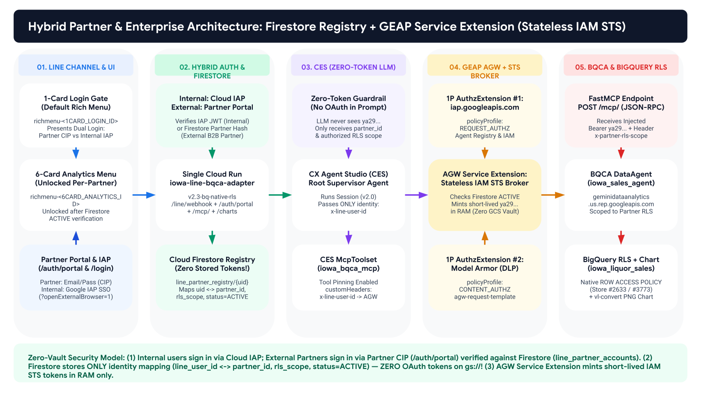
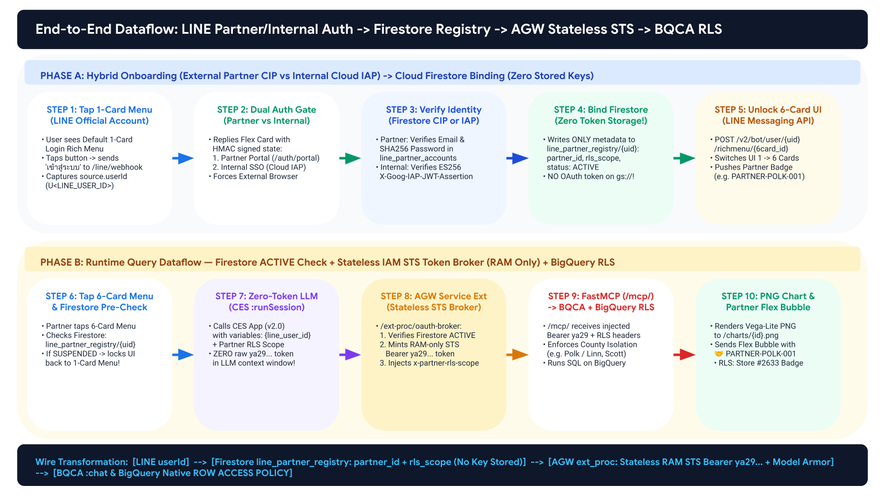
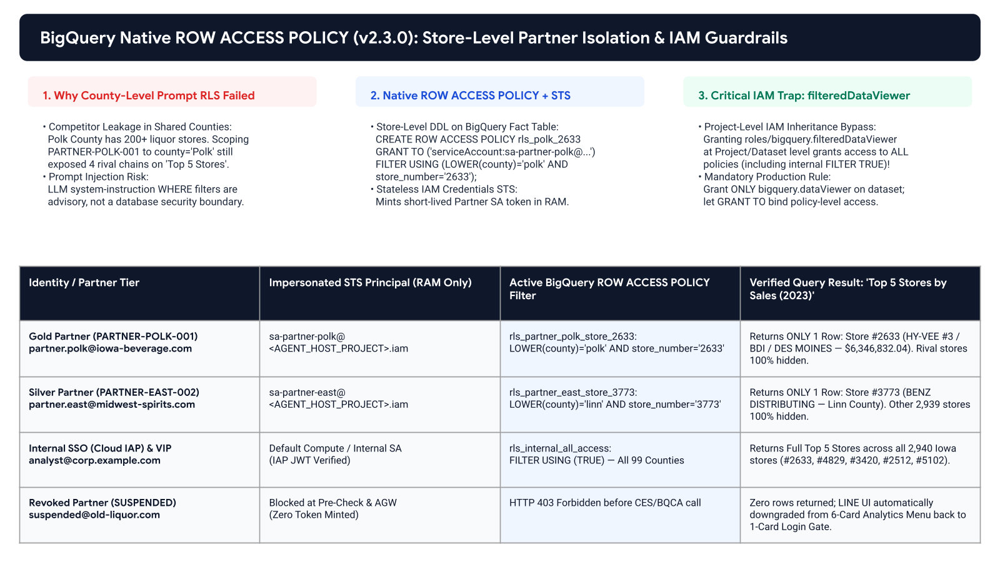
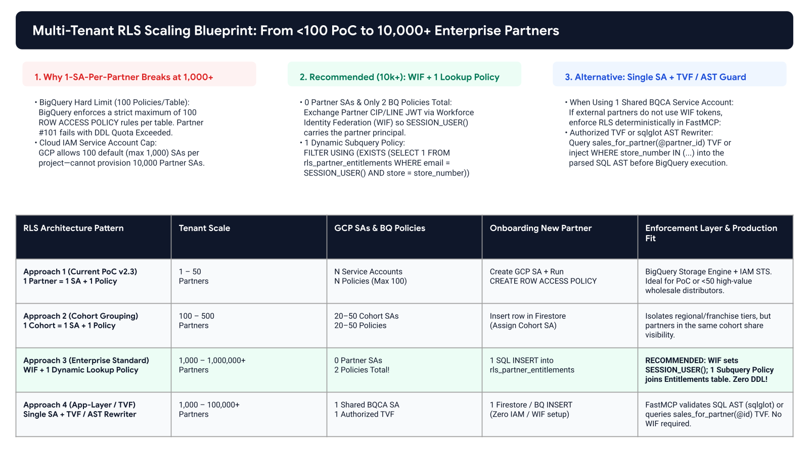

# LINE Official Account to CX Agent Studio (CES), GEAP Agent Gateway & BigQuery Conversational Analytics (BQCA)

> **Reference Architecture & Production Blueprint (`v2.3.0-bq-native-rls`)**  
> **End-to-End Governed Conversational Analytics on LINE OA with Hybrid Identity (Cloud IAP + Firestore Partner Registry), Stateless IAM STS Token Broker, and BigQuery Native `ROW ACCESS POLICY`**

---

## 1. Executive Overview

This repository provides a complete, production-verified reference implementation connecting a **LINE Official Account (Messaging API)** to **Google Cloud Next-Gen CX Agent Studio (CES)**, governed by **GEAP Agent Gateway (`networkservices.googleapis.com`)**, **FastMCP**, **BigQuery Conversational Analytics (`geminidataanalytics.googleapis.com`)**, and **BigQuery Native Row-Level Security (`ROW ACCESS POLICY`)**.



### Key Architectural Capabilities

1. **Sub-50ms LINE Webhook Acknowledgement & 22-Second Free `replyToken` Guard**:
   - Validates `X-Line-Signature` (`HMAC-SHA256`) against raw HTTP request bytes, returns `200 OK` immediately, triggers LINE's native Chat Loading animation (`/v2/bot/chat/loading/start`), and delivers responses within `< 22.0s` via the **free `replyToken` API** (`$0.00` Push message cost), automatically falling back to `/v2/bot/message/push` if a heavy query exceeds 22 seconds.
2. **Per-User Dynamic Rich Menu State Machine (`1-Card Login Gate` $\rightarrow$ `6-Card Analytics Menu`)**:
   - Unauthenticated LINE users see a **1-Card Login Gate Rich Menu**.
   - After completing authentication (either via **Cloud Identity-Aware Proxy (IAP)** for internal employees or the **Partner Identity Portal** backed by **Cloud Firestore** for external B2B partners), the adapter links the **6-Card Analytics Rich Menu** strictly to that `line_user_id`.
3. **Zero-Token LLM Context & Stateless IAM STS Token Broker**:
   - **Zero OAuth tokens (`ya29...`) are ever stored on Cloud Storage (`gs://`) or passed into the LLM prompt/session variables.**
   - Cloud Firestore stores **only** identity and entitlement metadata (`line_user_id` $\leftrightarrow$ `partner_id`, `service_account`, `rls_policy_name`, `status: ACTIVE | SUSPENDED`).
   - At query runtime, the **Stateless IAM STS Broker** (`/ext-proc/oauth-broker` & `/mcp/`) verifies `status == ACTIVE` in Firestore and mints a short-lived Google OAuth 2.0 access token in **RAM only** (`iamcredentials.googleapis.com` `generateAccessToken`).
4. **Physical Store-Level Data Isolation via BigQuery Native `ROW ACCESS POLICY`**:
   - Eliminates prompt-only filtering risks by enforcing **BigQuery Native `ROW ACCESS POLICY`** at the storage engine layer.
   - Includes production SQL blueprints for both **PoC scale (`< 50 Partners` via Per-Partner Service Accounts)** and **Enterprise scale (`1,000 – 1,000,000+ Partners` via Workforce Identity Federation + 1 Dynamic Lookup Policy or Authorized TVF)**.

---

## 2. End-to-End Dataflow Diagram



---

## 3. Multi-Tenant BigQuery RLS Scaling Blueprint (`< 50` to `10,000+` Partners)





| RLS Architecture Pattern | Target Tenant Scale | GCP SAs & BQ Policies | Partner Onboarding Effort | SQL Blueprint in Repo |
| :--- | :--- | :--- | :--- | :--- |
| **Approach 1: Per-Partner SA + Static Policy** | `1 – 50 Partners` *(PoC / VIP Wholesale)* | `N` SAs / `N` Policies *(Hard limit: 100 policies/table)* | Create SA + Run `CREATE ROW ACCESS POLICY` | [`sql/01_poc_partner_sa_row_access_policies.sql`](sql/01_poc_partner_sa_row_access_policies.sql) |
| **Approach 2: Cohort / Tier Service Accounts** | `100 – 500 Partners` *(Regional / Franchise)* | `20–50` Cohort SAs / `20–50` Policies | Assign `cohort_sa` in Firestore | [`docs/RLS_SCALING_ARCHITECTURE.md`](docs/RLS_SCALING_ARCHITECTURE.md) |
| **Approach 3: Workforce Identity Federation (WIF) + 1 Dynamic Subquery Policy *(Recommended)*** | **`1,000 – 1,000,000+ Partners`** | **`0` Partner SAs / `2` Policies Total!** | **1 SQL `INSERT` into `rls_partner_entitlements` (Zero DDL!)** | [`sql/02_enterprise_wif_dynamic_rls_10k_users.sql`](sql/02_enterprise_wif_dynamic_rls_10k_users.sql) |
| **Approach 4: Single Shared SA + Authorized TVF / SQL AST Rewriter** | `1,000 – 100,000+ Partners` *(No WIF)* | `1` Shared SA / `1` Authorized TVF | 1 SQL `INSERT` into `rls_partner_entitlements` | [`sql/03_authorized_tvf_parameterized_rls.sql`](sql/03_authorized_tvf_parameterized_rls.sql) |

---

## 4. Repository Structure

```text
line-ces-agw-bqca-blueprint/
├── .env.example                        # Parameterized environment variable template (zero secrets)
├── README.md                           # Architecture overview & quickstart
├── docs/
│   ├── IMPLEMENTATION_GUIDE.md         # Step-by-step customer deployment & operations guide
│   ├── RLS_SCALING_ARCHITECTURE.md     # Deep-dive on scaling BigQuery RLS to 10,000+ users
│   └── SECURITY_AND_AUDIT_CHECKLIST.md # Security guardrails & PII redaction verification
├── services/
│   ├── line-bqca-adapter/              # Cloud Run Adapter: LINE Webhook + Partner Portal + FastMCP + STS Broker
│   │   ├── main.py
│   │   ├── Dockerfile
│   │   └── requirements.txt
│   └── line-iap-auth/                  # Cloud Run Internal Employee Gate (--iap) + Firestore Binding
│       ├── main.py
│       ├── Dockerfile
│       └── requirements.txt
├── sql/
│   ├── 01_poc_partner_sa_row_access_policies.sql   # Approach 1 (<50 partners)
│   ├── 02_enterprise_wif_dynamic_rls_10k_users.sql # Approach 3 (10,000+ partners via WIF + Subquery Policy)
│   └── 03_authorized_tvf_parameterized_rls.sql     # Approach 4 (Single SA + Authorized TVF)
├── scripts/
│   ├── deploy_cloud_run.sh             # Deploys Cloud Run services & resolves runtime URLs
│   ├── provision_ces_and_registry.py   # Registers FastMCP in GEAP Agent Registry & seeds Firestore
│   ├── configure_line_richmenus.py     # Uploads 1-Card Login & 6-Card Analytics Rich Menus to LINE OA
│   └── verify_e2e_rls.py               # Automated E2E test suite for Partner Auth, STS, and Store RLS
└── assets/
    ├── diagrams/                       # High-DPI architecture & dataflow diagrams
    └── richmenus/                      # Production 2500x843 (1-Card) & 2500x1686 (6-Card) PNG assets
```

---

## 5. Quickstart (5 Commands)

```bash
# 1. Copy and configure your environment variables
cp .env.example .env
# Edit .env with your GCP_PROJECT_ID, BQ_DATA_PROJECT_ID, CES_APP_ID, and BQCA_AGENT_ID

# 2. Apply BigQuery Native Row Access Policies (PoC or 10,000+ Enterprise WIF)
bq query --use_legacy_sql=false < sql/01_poc_partner_sa_row_access_policies.sql

# 3. Provision LINE Rich Menus (1-Card Login Gate + 6-Card Analytics Menu)
python3 scripts/configure_line_richmenus.py

# 4. Deploy Cloud Run services & configure IAM impersonation
chmod +x scripts/deploy_cloud_run.sh
./scripts/deploy_cloud_run.sh

# 5. Register MCP Server in GEAP Agent Registry, seed Firestore, and run E2E verification
python3 scripts/provision_ces_and_registry.py
python3 scripts/verify_e2e_rls.py
```

For full step-by-step instructions, see **[`docs/IMPLEMENTATION_GUIDE.md`](docs/IMPLEMENTATION_GUIDE.md)** and **[`docs/RLS_SCALING_ARCHITECTURE.md`](docs/RLS_SCALING_ARCHITECTURE.md)**.
