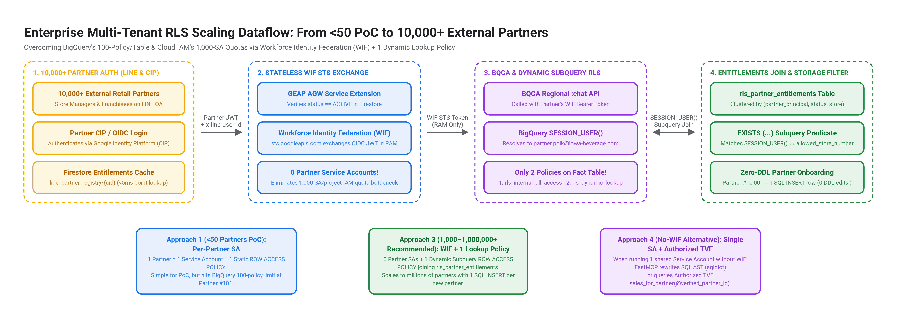

# LINE Official Account to CX Agent Studio (CES), GE Agent Gateway & BigQuery Conversational Analytics (BQCA)

> **Reference Architecture & Production Blueprint (`v2.4.0-gcaf-geap-agw`)**  
> **End-to-End Governed Conversational Analytics on LINE OA Aligned with Google Cloud Architecture Framework (`GCAF`), Gemini Enterprise Agent Platform (`GEAP`), and `GE Agent Gateway` Security Best Practices**

---

## 1. Executive Overview

This repository provides a complete, production-verified reference implementation connecting a **LINE Official Account (Messaging API)** to **Google Cloud Next-Gen CX Agent Studio (CES)**, governed by **GE Agent Gateway (`networkservices.googleapis.com`)**, **FastMCP**, **BigQuery Conversational Analytics (`geminidataanalytics.googleapis.com`)**, and **BigQuery Native Row-Level Security (`ROW ACCESS POLICY`)**.

## Demo Video :
https://github.com/user-attachments/assets/61b716f9-d80e-4207-84e4-1a7dcc5ca5d2

### GCAF + GEAP + GE Agent Gateway Security Reference Architecture (`assets/diagrams/detailed_architecture_flow_gcaf_geap_agw.png`)


### Key Architectural Capabilities (`v2.4.0-gcaf-geap-agw`)

1. **Production OAuth 2.0 / OIDC Identity Federation (`GCIP / Firebase Auth`, `Auth0 / Okta`, and `Cloud IAP`)**:
   - **External B2B Partners & Consumers**: Authenticate via **Google Cloud Identity Platform (`GCIP` / Firebase Authentication, `identitytoolkit.googleapis.com`)** (free for the first `50,000 MAUs`, with native **LINE Login OIDC `https://access.line.me`** federation and `beforeSignIn` Blocking Functions injecting `{partner_id, store_number}` claims), or via **Enterprise BYO-IdP (`Auth0` / `Okta` / `Entra ID`)** federated into **GCP Workforce Identity Federation (`WIF`)**.
   - **Internal Employees**: Authenticate via **Cloud Identity-Aware Proxy (`Cloud IAP`)** (`X-Goog-IAP-JWT-Assertion`).
2. **Zero `x-token` in CES MCP & Runtime WIF / IAM STS Token Broker at GE Agent Gateway**:
   - **Zero OAuth tokens (`ya29...`) are ever stored on Cloud Storage (`gs://`), in Firestore, or passed into CES LLM prompts / MCP tool arguments.**
   - **3LO Refresh Tokens** (when calling external 3P APIs) are vaulted in **GE Agent Identity Auth Manager** (encrypted with Cloud KMS CMEK).
   - **CES `McpToolset`** passes **ONLY** `customHeaders: {"x-line-user-id": "$context.variables.line_user_id"}` (and `ask_iowa_sales_agent(question)` exposes **only** `question`, with zero `x-token` parameter).
   - **GE Agent Gateway (`agent-gateway-in`)** intercepts the MCP call via its **Service Extension (`POST /ext-proc/oauth-broker`)**, verifies `status == ACTIVE` in Firestore, exchanges a short-lived (`5–15 min` TTL) **WIF / IAM STS token (`sts.googleapis.com/v1/token`) in RAM**, and injects `Authorization: Bearer <sts_token>` + `x-agw-*` headers into `POST /mcp/`.
3. **Sub-50ms LINE Webhook Acknowledgement & 22-Second Free `replyToken` Guard**:
   - Validates `X-Line-Signature` (`HMAC-SHA256`) against raw HTTP request bytes, returns `200 OK` immediately, triggers LINE's native Chat Loading animation (`/v2/bot/chat/loading/start`), and delivers responses within `< 22.0s` via the **free `replyToken` API** (`$0.00` Push message cost), automatically falling back to `/v2/bot/message/push` if a heavy query exceeds 22 seconds.
4. **Physical Store-Level Data Isolation via BigQuery Native `ROW ACCESS POLICY` & `VPC-SC`**:
   - Enforces **BigQuery Native `ROW ACCESS POLICY`** at the storage engine layer inside a **VPC Service Controls (`VPC-SC`)** perimeter, paired with **Model Armor (`CONTENT_AUTHZ`)** for inline Prompt Injection (`PIJB`) and Sensitive Data Protection (`SDP/DLP`).

---

## 2. End-to-End Dataflow Diagram (`Zero x-token` in CES MCP)

### 2.1 High-DPI 17-Step Wire-Level Sequence Diagram (`assets/diagrams/detailed_sequence_flow_phase_a_and_b.png`)


### 2.2 10-Step Sequence & Wire Transformation (`assets/diagrams/slide_8_end_to_end_dataflow_diagram.png`)


---

## 3. Multi-Tenant BigQuery RLS Scaling Blueprint (`< 50` to `10,000+` Partners)




| RLS Architecture Pattern | Target Tenant Scale | GCP SAs & BQ Policies | Partner Onboarding Effort | SQL Blueprint in Repo |
| :--- | :--- | :--- | :--- | :--- |
| **Approach 1: Per-Partner SA + Static Policy** | `1 – 50 Partners` *(PoC / VIP Wholesale)* | `N` SAs / `N` Policies *(Hard limit: 100 policies/table)* | Create SA + Run `CREATE ROW ACCESS POLICY` | [`sql/01_poc_partner_sa_row_access_policies.sql`](sql/01_poc_partner_sa_row_access_policies.sql) |
| **Approach 2: Cohort / Tier Service Accounts** | `100 – 500 Partners` *(Regional / Franchise)* | `20–50` Cohort SAs / `20–50` Policies | Assign `cohort_sa` in Firestore | [`docs/RLS_SCALING_ARCHITECTURE.md`](docs/RLS_SCALING_ARCHITECTURE.md) |
| **Approach 3: Workforce Identity Federation (WIF) + 1 Dynamic Subquery Policy *(Recommended)*** | **`1,000 – 1,000,000+ Partners`** | **`0` Partner SAs / `2` Policies Total!** | **1 SQL `INSERT` into `rls_partner_entitlements` (Zero DDL!)** | [`sql/02_enterprise_wif_dynamic_rls_10k_users.sql`](sql/02_enterprise_wif_dynamic_rls_10k_users.sql) |
| **Approach 4: Single Shared SA + Authorized TVF / SQL AST Rewriter** | `1,000 – 100,000+ Partners` *(No WIF)* | `1` Shared SA / `1` Authorized TVF | 1 SQL `INSERT` into `rls_partner_entitlements` | [`sql/03_authorized_tvf_parameterized_rls.sql`](sql/03_authorized_tvf_parameterized_rls.sql) |

---

## 4. Repository Structure

```text
line-ces-agw-bqca-blueprint/
├── .env.example                             # Parameterized environment variable template (zero secrets)
├── README.md                                # Architecture overview & quickstart
├── docs/
│   ├── GCAF_GEAP_SECURITY_ARCHITECTURE.md   # Deep-dive: OAuth/OIDC (Firebase/Auth0), Token Vault, Zero x-token & GCAF/GEAP
│   ├── IMPLEMENTATION_GUIDE.md              # Step-by-step customer deployment & operations guide
│   ├── RLS_SCALING_ARCHITECTURE.md          # Deep-dive on scaling BigQuery RLS to 10,000+ users
│   └── SECURITY_AND_AUDIT_CHECKLIST.md      # Security guardrails & PII redaction verification
├── services/
│   ├── line-bqca-adapter/                   # Cloud Run Adapter: LINE Webhook + AGW ext_proc STS Broker + FastMCP (/mcp/)
│   │   ├── main.py
│   │   ├── Dockerfile
│   │   └── requirements.txt
│   └── line-iap-auth/                       # Cloud Run Internal Employee Gate (--iap) + Firestore Binding
│       ├── main.py
│       ├── Dockerfile
│       └── requirements.txt
├── sql/
│   ├── 01_poc_partner_sa_row_access_policies.sql   # Approach 1 (<50 partners)
│   ├── 02_enterprise_wif_dynamic_rls_10k_users.sql # Approach 3 (10,000+ partners via WIF + Subquery Policy)
│   └── 03_authorized_tvf_parameterized_rls.sql     # Approach 4 (Single SA + Authorized TVF)
├── scripts/
│   ├── deploy_cloud_run.sh                  # Deploys Cloud Run services & resolves runtime URLs
│   ├── provision_ces_and_registry.py        # Registers FastMCP in GEAP Agent Registry & seeds Firestore
│   ├── configure_line_richmenus.py          # Uploads 1-Card Login & 6-Card Analytics Rich Menus to LINE OA
│   └── verify_e2e_rls.py                    # Automated E2E test suite for Partner Auth, STS, and Store RLS
└── assets/
    ├── diagrams/                            # High-DPI architecture & dataflow diagrams (.png, .svg, .json)
    └── richmenus/                           # Production 2500x843 (1-Card) & 2500x1686 (6-Card) PNG assets
```

---

## 5. Quickstart (5 Commands)

```bash
# 1. Copy and configure your environment variables
cp .env.example .env
# Edit .env with your GCP_PROJECT_ID, BQ_DATA_PROJECT_ID, CES_APP_ID, and BQCA_AGENT_ID

# 2. Apply BigQuery Native Row Access Policies (PoC or 10,000+ Enterprise WIF)
bq query --use_legacy_sql=false < sql/01_poc_partner_sa_row_access_policies.sql

# 3. Provision LINE Rich Menus (1-Card Login Gate + 6-Card Analytics Menu)
python3 scripts/configure_line_richmenus.py

# 4. Deploy Cloud Run services & configure IAM impersonation
chmod +x scripts/deploy_cloud_run.sh
./scripts/deploy_cloud_run.sh

# 5. Register MCP Server in GEAP Agent Registry, seed Firestore, and run E2E verification
python3 scripts/provision_ces_and_registry.py
python3 scripts/verify_e2e_rls.py
```

For full security architecture details, see **[`docs/GCAF_GEAP_SECURITY_ARCHITECTURE.md`](docs/GCAF_GEAP_SECURITY_ARCHITECTURE.md)**, **[`docs/IMPLEMENTATION_GUIDE.md`](docs/IMPLEMENTATION_GUIDE.md)**, and **[`docs/RLS_SCALING_ARCHITECTURE.md`](docs/RLS_SCALING_ARCHITECTURE.md)**.
