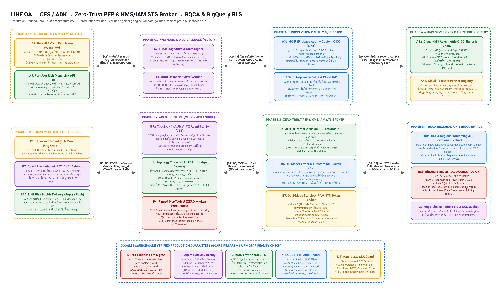

# Production-Verified Zero-Trust Security Architecture (`v2.5.0-production-verified`)

> **Production OAuth 2.0 / OIDC Identity Selection (`GCIP / Firebase Auth Custom OIDC` vs `Auth0` vs `Cloud IAP`), Cloud KMS Asymmetric OIDC Signer & Workforce Identity Pool STS, Zero `x-token` MCP Contract, and `google3` Source-Code Verification**

---

## 1. Production OAuth 2.0 / OIDC Identity Provider (IdP) Selection

| Identity Provider (IdP) Option | Target User Segment | How It Integrates with LINE OA & GCP | Pricing & Free Tier | Verdict & Recommendation |
| :--- | :--- | :--- | :--- | :--- |
| **1. Google Cloud Identity Platform (`GCIP`) / Firebase Authentication** (`identitytoolkit.googleapis.com`) | **External B2B Partners, Franchisees & Consumers (`B2B2C`)** | • **100% Firebase Auth SDK compatible** with enterprise SLAs, Multi-Tenancy, MFA, and Cloud Armor. • Configures **LINE Login as a Custom OIDC Provider** (`oidc.line` $\rightarrow$ `issuer: https://access.line.me`) for 1-tap login inside LINE external browser (`?openExternalBrowser=1`). • Uses **`beforeSignIn` Blocking Functions** (Cloud Run) to look up `rls_partner_entitlements` and inject custom claims (`{partner_id, store_number, rls_tier}`) directly into the signed OIDC JWT! | **Free up to `50,000 MAUs`** (Tier 1 OIDC/Email/Social); `\$0.0055/MAU` beyond 50k | **PRIMARY RECOMMENDATION** for GCP-native deployments without an existing commercial CIAM contract. |
| **2. Enterprise BYO-IdP (`Auth0` / `Okta` / `Microsoft Entra ID`)** | **Enterprises with Existing Commercial CIAM / Workforce Directory** | • Federates into GCP via **OIDC or SAML 2.0** into either **GCIP** or directly into a **GCP Workforce Identity Pool (`locations/global/workforcePools/...`)** (`sts.googleapis.com/v1/token`). • Auth0 Actions / Okta Inline Hooks inject `partner_id` and `store_number` claims into the OIDC token, mapped to `google.subject` and `attribute.partner_id` in the Workforce Pool. | Uses customer's existing Auth0 / Okta license (`\$0` GCP WIF fee) | **RECOMMENDED WHEN** the enterprise already standardizes on Auth0, Okta, or Entra ID across B2B portals. |
| **3. Cloud Identity-Aware Proxy (`Cloud IAP`) + Google Workspace** | **Internal Employees, Executives & HQ Analysts** | • Enforced on browser-facing `/auth/login` (`--iap`). • Verifies `X-Goog-IAP-JWT-Assertion` (`ES256`) and binds the employee's corporate identity (`ALL_IOWA` RLS scope) in `line_partner_registry/{uid}`. | Included with Google Cloud / Workspace | **MANDATORY FOR INTERNAL STAFF** (Never expose internal HQ analytics via shared passwords). |

---

## 2. Solving the 1-Hour OIDC `id_token` Expiry for Stateless STS (`sts.googleapis.com/v1/token`)

An external OIDC `id_token` issued by LINE Login, GCIP (Firebase Auth), or Auth0 expires after **1 hour (`3600s`)**. Because `POST https://sts.googleapis.com/v1/token` (RFC 8693) is a **stateless cryptographic token exchange** that requires a live, non-expired `subject_token` on every call, storing only `{oidc_sub, partner_id, status: ACTIVE}` in Firestore is not enough by itself unless paired with a server-side cryptographic signer or SA impersonation:

### Dual-Mode Stateless RAM Token Broker (`v2.5.0-production-verified`)

1. **Mode A (`1,000 – 1,000,000+` Partners, `0` Partner SAs) — Cloud KMS Asymmetric OIDC Signer + GCP Workforce Identity Pool (`workforcePools`)**:
   - The Cloud Run Token Broker provisions an asymmetric RSA-2048 signing key in **Cloud KMS** (`projects/<PROJECT_ID>/locations/us-central1/keyRings/line-agw-oidc-ring/cryptoKeys/partner-jwt-signer/cryptoKeyVersions/1`, `RSA_SIGN_PKCS1_2048_SHA256`) and exposes standard OIDC discovery endpoints:
     - `GET /.well-known/openid-configuration`
     - `GET /.well-known/jwks.json`
   - When a verified `ACTIVE` partner sends a message on LINE days or weeks after initial onboarding, the Token Broker calls `cloudkms.googleapis.com/v1/...:asymmetricSign` to sign a **5-minute JWT assertion** (`{iss, sub: line_user_id, aud, partner_id, rls_scope}`) in RAM and exchanges it at `POST https://sts.googleapis.com/v1/token` against a **GCP Workforce Identity Pool (`locations/global/workforcePools/...`)**.
   - **Zero user refresh tokens are ever stored in Firestore or Cloud Storage (`gs://`)!**
2. **Mode B (`< 50` Partners / Store Cohort SAs) — IAM Service Account Impersonation (`iamcredentials.googleapis.com`)**:
   - Mints a short-lived (`900s–3500s`) access token in RAM via `POST https://iamcredentials.googleapis.com/v1/projects/-/serviceAccounts/{partner_sa}:generateAccessToken` (e.g., `sa-partner-polk@...` for Store `#2633` or `sa-partner-east@...` for Store `#3773`).

---

## 3. `google3` Source-Code Reality Check (`validate.go`, `mcp_toolset.proto` & `ChatAction.kt`)

| Architectural Boundary | Verified `google3` Behavior | Production Implementation in `v2.5.0-production-verified` |
| :--- | :--- | :--- |
| **1. `CES` $\rightarrow$ `McpToolset` Zero `x-token` Contract** | `google/cloud/ces/v1main/mcp_toolset.proto` natively supports `custom_headers: {"x-line-user-id": "$context.variables.line_user_id"}`. | `App.variableDeclarations` contains only `line_user_id` and `line_reply_token`. `MCP_TOOL_SCHEMA` exposes only `ask_iowa_sales_agent(question: string)` (zero `x-token` parameter). |
| **2. `CES` vs. `Google-Managed GE Agent Gateway` (`networkservices.googleapis.com/AgentGateway`)** | 1) `validate.go:749-755` & `AgentGatewayAuthzExtensions_FeatureSettings.gcl` reject custom customer `AuthzExtension` backends on Google-Managed `AgentGateway` (supporting only 1P `Cloud IAP` and 1P `Model Armor`). 2) `ces.googleapis.com` has no `agent_gateway_config` mTLS client binding (only Vertex AI `ReasoningEngine` and `DiscoveryEngine` have `agent_gateway_config`). | Supports **two 100%-valid topologies**: • **Topology 1 (`CES`)**: `CES McpToolset` (`service_account_auth_config` `roles/run.invoker` + `x-line-user-id`) $\rightarrow$ **Regional ALB `LbTrafficExtension` (`/ext-proc/oauth-broker`) OR Cloud Run FastMCP Zero-Trust PEP Middleware**. • **Topology 2 (`Vertex AI ADK` + `Managed AgentGateway`)**: `ADK ReasoningEngine` (`AGENT_IDENTITY` + `agent_gateway_config`) $\rightarrow$ **Google-Managed `AgentGateway` (1P IAP + 1P Model Armor + PSC `10.10.20.2`)** $\rightarrow$ **Cloud Run FastMCP Zero-Trust PEP Middleware**. |
| **3. `BQCA` (`geminidataanalytics.us.rep.googleapis.com/...:chat`) Credentials Channel** | In `ChatAction.kt:1695-1720` and `credentials.proto`, `ChatRequest.credentials` (`OAuthCredentials.TokenBased`) is only converted for **Looker, AlloyDB, and Cloud SQL**—NOT BigQuery. For BigQuery, `DataChatService.Chat` always uses the caller's **HTTP `Authorization: Bearer <token>` header**. | FastMCP passes `Authorization: Bearer <sts_or_sa_token>` in the **HTTP Request Header** of `POST https://geminidataanalytics.us.rep.googleapis.com/v1beta/.../locations/us:chat` so BigQuery `ROW ACCESS POLICY` evaluates `SESSION_USER()` properly. |
