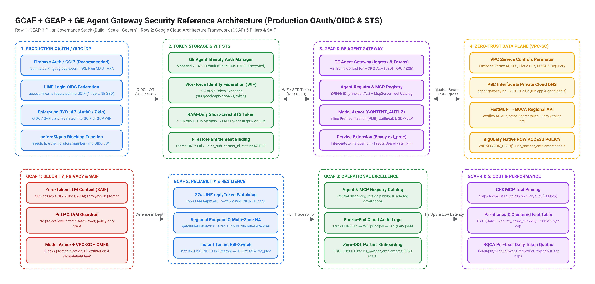
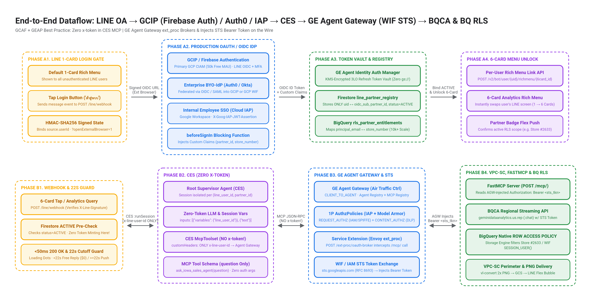

# GCAF + GEAP + GE Agent Gateway Security Reference Architecture (`v2.4.0-gcaf-geap-agw`)

> **Production OAuth 2.0 / OIDC Identity Selection (`GCIP / Firebase Auth` vs `Auth0` vs `Cloud IAP`), Token Storage & Exchange (`GE Agent Identity Auth Manager` + `WIF STS`), Zero `x-token` MCP Contract, and Complete `GCAF` + `GEAP` Security Best Practices**



---

## 1. Production OAuth 2.0 / OIDC Identity Provider (IdP) Selection

When moving from a sandbox prototype to an enterprise production deployment serving internal employees, B2B retail partners, and consumers over LINE Official Account (`LINE OA`), choose your OAuth 2.0 / OIDC Identity Provider based on user population and existing enterprise investments:

| Identity Provider (IdP) Option | Target User Segment | How It Integrates with LINE OA & GCP | Pricing & Free Tier | Verdict & Recommendation |
| :--- | :--- | :--- | :--- | :--- |
| **1. Google Cloud Identity Platform (`GCIP`) / Firebase Authentication** (`identitytoolkit.googleapis.com`) | **External B2B Partners, Franchisees & Consumers (`B2B2C`)** | • **100% Firebase Auth SDK compatible** with enterprise SLAs, Multi-Tenancy, MFA, and Cloud Armor.<br>• Supports **Native LINE Login OIDC Federation** (`issuer: https://access.line.me`) for 1-tap login inside LINE external browser/LIFF.<br>• Uses **`beforeSignIn` Blocking Functions** (Cloud Run) to look up `rls_partner_entitlements` and inject custom claims (`{partner_id, store_number, rls_tier}`) directly into the signed OIDC JWT! | **Free up to `50,000 MAUs`** (Tier 1 OIDC/Email/Social); `$0.0055/MAU` beyond 50k | **PRIMARY RECOMMENDATION** for GCP-native deployments without an existing commercial CIAM contract. |
| **2. Enterprise BYO-IdP (`Auth0` / `Okta` / `Microsoft Entra ID`)** | **Enterprises with Existing Commercial CIAM / Workforce Directory** | • Federates into GCP via **OIDC or SAML 2.0** into either **GCIP** or directly into **GCP Workforce Identity Federation (`WIF`)** (`sts.googleapis.com/v1/token`).<br>• Auth0 Actions / Okta Inline Hooks inject `partner_id` and `store_number` claims into the OIDC token, mapped to `google.subject` and `attribute.partner_id` in the WIF Pool. | Uses customer's existing Auth0 / Okta license (`$0` GCP WIF fee) | **RECOMMENDED WHEN** the enterprise already standardizes on Auth0, Okta, or Entra ID across B2B portals. |
| **3. Cloud Identity-Aware Proxy (`Cloud IAP`) + Google Workspace** | **Internal Employees, Executives & HQ Analysts** | • Enforced on browser-facing `/auth/login` (`--iap`).<br>• Verifies `X-Goog-IAP-JWT-Assertion` (`ES256`) and binds the employee's corporate identity (`ALL_IOWA` RLS scope) in `line_partner_registry/{uid}`. | Included with Google Cloud / Workspace | **MANDATORY FOR INTERNAL STAFF** (Never expose internal HQ analytics via shared passwords). |

> **Why Not Raw LINE Login OIDC Alone?**  
> LINE Login (`https://access.line.me`) authenticates the user's consumer LINE account (`sub = U...`), **not** their B2B Partner organization, store entitlement (`Store #2633`), or B2B account suspension status. By federating LINE Login OIDC **into GCIP (Firebase Auth) or Auth0**, the user gets 1-tap LINE login UX while GCIP's `beforeSignIn` Blocking Function enforces B2B partner verification and stamps `{partner_id, store_number}` into the OIDC token.

---

## 2. Production Token Storage & Runtime STS Exchange Architecture

A frequent security anti-pattern in conversational agents is storing raw OAuth 2.0 `access_token` / `refresh_token` files on Cloud Storage (`gs://`), in plain Firestore fields, or passing tokens through LLM session variables.

### Our 3-Tier Zero-Trust Token Architecture

1. **Where 3LO Refresh Tokens Live (When Calling External 3P OAuth APIs)**:
   - Stored exclusively in **GE Agent Identity Auth Manager** (Google Cloud's managed credential vault for agents, encrypted at rest with **Cloud KMS CMEK**) or **Google Cloud Secret Manager**.
   - **Never** store `ya29...` access tokens or refresh tokens in Cloud Storage (`gs://`) buckets (where any principal with `roles/storage.objectViewer` on chart assets can exfiltrate all users' tokens, and where soft-delete/versioning retains tokens after logout).
2. **Where Identity & Entitlement Bindings Live (`Cloud Firestore`)**:
   - `projects/<PROJECT_ID>/databases/(default)/documents/line_partner_registry/{line_user_id}` stores **ONLY** non-secret identity bindings:
     ```json
     {
       "line_user_id": "U...",
       "oidc_sub": "gcip-uid-or-auth0-sub",
       "idp_provider": "GCIP_FIREBASE_AUTH",
       "partner_id": "PARTNER-POLK-001",
       "rls_policy_name": "rls_partner_polk_store_2633",
       "rls_scope": "Polk (Store #2633)",
       "status": "ACTIVE"
     }
     ```
3. **Where Runtime Access Tokens Live (`RAM-Only Short-Lived WIF / IAM STS`)**:
   - On every MCP tool call, **GE Agent Gateway (`agent-gateway-in`)** invokes its **Service Extension (`POST /ext-proc/oauth-broker`)**.
   - The broker verifies `status == "ACTIVE"` in Firestore and exchanges the partner's verified identity via **Workforce Identity Federation (WIF) / IAM Security Token Service (`sts.googleapis.com/v1/token`, RFC 8693)** or `iamcredentials.googleapis.com` (`generateAccessToken`) with a short **`5–15 minute` TTL held strictly in process RAM (`STS_TOKEN_MEM_CACHE`)**.

---

## 3. Eliminating the `x-token` Contradiction Between `CES MCP` $\rightarrow$ `GE Agent Gateway` $\rightarrow$ `BQCA Adapter`

### Why Earlier Diagrams Had a Contradiction
In an earlier iteration (`Step 1`), the Webhook Bridge minted a user OAuth token and passed it into CES `SessionInput.variables` (`user_oauth_token`), which CES `McpToolset` forwarded as an HTTP header (`x-goog-user-token` / `x-token`) to the MCP server.  
**That violated Zero-Trust / SAIF best practices** because:
1. Passing an OAuth token into `ces.googleapis.com` session variables exposes bearer credentials to the orchestration state and risks prompt-injection leakage.
2. If **GE Agent Gateway** is the policy enforcement point (PEP) and token broker, **CES must never hold or forward an OAuth token**.

### The Corrected `v2.4.0-gcaf-geap-agw` Wire Contract (Zero `x-token`)



1. **`Webhook Bridge` $\rightarrow$ `CES (:runSession)`**:
   - Passes **ONLY** `inputs: [{"variables": {"line_user_id": "U...", "line_reply_token": "..."}}, {"text": "..."}]`.
   - `App.variableDeclarations` declares **ONLY** `line_user_id` and `line_reply_token` (`user_oauth_token` is completely removed).
2. **`CES McpToolset` (`toolsets/iowa_bqca_mcp`) $\rightarrow$ `GE Agent Gateway`**:
   - Configures `customHeaders` with **ONLY** the caller's channel identifier:
     ```json
     {
       "customHeaders": {
         "x-line-user-id": "$context.variables.line_user_id"
       }
     }
     ```
   - And `MCP_TOOL_SCHEMA` exposes **ONLY** `question` (`ask_iowa_sales_agent(question: string)`) — **zero `x-token`, `user_oauth_token`, or `line_user_id` parameters in the LLM tool schema!**
3. **`GE Agent Gateway` (`agent-gateway-in`) $\rightarrow$ `Service Extension (Envoy ext_proc)`**:
   - Intercepts the MCP request before it reaches `/mcp/`.
   - Calls `POST /ext-proc/oauth-broker` with `x-line-user-id`.
   - `/ext-proc/oauth-broker` verifies `status == "ACTIVE"` in Firestore, performs the WIF / IAM STS exchange in RAM, and returns header mutations:
     - `Authorization: Bearer <short_lived_sts_token>`
     - `x-agw-verified-partner-id: PARTNER-POLK-001`
     - `x-agw-rls-policy: rls_partner_polk_store_2633`
     - `x-agw-rls-scope: Polk (Store #2633)`
4. **`GE Agent Gateway` $\rightarrow$ `FastMCP Server (POST /mcp/)` $\rightarrow$ `BQCA (:chat)`**:
   - `POST /mcp/` extracts the STS Bearer token and RLS metadata strictly from the **AGW-injected headers** (`resolve_agw_injected_context(request)`) and forwards `Authorization: Bearer <short_lived_sts_token>` to `geminidataanalytics.us.rep.googleapis.com/v1beta/...:chat`.

---

## 4. Complete Alignment with `GCAF`, `GEAP`, and `GE Agent Gateway` Best Practices

### 4.1 Gemini Enterprise Agent Platform (`GEAP`) — 3-Pillar Governance Stack
1. **Build (`CX Agent Studio + BQCA + ADK`)**:
   - Domain-specialized `DataAgent` (`iowa_sales_agent`) with curated schema context and regional endpoint isolation (`geminidataanalytics.us.rep.googleapis.com`).
   - Deterministic 2-element `SessionInput` wire format and **CES Tool Pinning (`fetchPinnedToolsIfPossible`)** eliminating `tools/list` round-trips (`-300ms` per turn).
2. **Scale (`Agent Registry & MCP Registry — agentregistry.googleapis.com`)**:
   - Every agent (`iowa_sales_agent`) is assigned a cryptographic **Agent Identity (`SPIFFE ID`: `principal://...`)**.
   - Every MCP server (`services/iowa-bqca-mcp`) is cataloged in `agentregistry.googleapis.com` with versioned `TOOL_SPEC` schemas.
3. **Govern (`GE Agent Gateway + Model Armor + Cloud Audit Logs`)**:
   - **`agent-gateway-in` (`CLIENT_TO_AGENT` Ingress Mode)** acts as the "Air Traffic Controller" for all MCP (`JSON-RPC / Streamable HTTP`) and A2A traffic.
   - **1P `AuthzPolicy` #1 (`REQUEST_AUTHZ` — `iap.googleapis.com`)**: Enforces IAM / SPIFFE caller authorization against Agent Registry.
   - **1P `AuthzPolicy` #2 (`CONTENT_AUTHZ` — `modelarmor.<region>.rep.googleapis.com`)**: Inline Prompt Injection & Jailbreak (`PIJB`) detection plus Sensitive Data Protection (`SDP/DLP`) on both MCP tool inputs and BQCA outputs.
   - **Custom `Service Extension` (`Envoy ext_proc` Callout)**: Performs zero-trust identity verification and WIF / IAM STS token brokering on the wire.

### 4.2 Google Cloud Architecture Framework (`GCAF`) — 5 Pillars + `SAIF`
1. **Pillar 1 — Security, Privacy & Compliance (`GCAF + SAIF`)**:
   - **Zero-Token LLM Context (SAIF)**: LLM never sees raw credentials.
   - **VPC Service Controls (`VPC-SC`)**: Encloses Vertex AI, CES, Cloud Run (`PSC Interface` + Private Cloud DNS), BQCA, and BigQuery inside a single security perimeter to prevent data exfiltration.
   - **Least Privilege (`PoLP`) BigQuery RLS**: Never grant `roles/bigquery.filteredDataViewer` at the Project/Dataset/Table level; bind it strictly via `CREATE ROW ACCESS POLICY ... GRANT TO (...)`.
2. **Pillar 2 — Reliability & Resilience**:
   - **Sub-50ms Webhook Ack & 22-Second `replyToken` Watchdog**: Protects against LINE's 25-second `replyToken` expiration with automatic async `/v2/bot/message/push` fallback.
   - **Instant Tenant Kill-Switch**: Setting `status = "SUSPENDED"` in Firestore immediately blocks the partner at `GE Agent Gateway` (`HTTP 403`) and resets their LINE Rich Menu back to the 1-Card Login Gate.
3. **Pillar 3 — Operational Excellence**:
   - **Zero-DDL Partner Onboarding (`10,000+` Scale)**: Onboarding a new retail store partner requires 1 row `INSERT` into `rls_partner_entitlements` (`0` new Service Accounts, `0` DDL changes).
   - **End-to-End Traceability**: Cloud Audit Logs (`DATA_READ`) correlate every BigQuery SQL job back to the WIF principal / Partner SA and `line_user_id`.
4. **Pillar 4 & 5 — Cost Optimization (`FinOps`) & Performance Efficiency**:
   - **Partitioned (`DATE(date)`) & Clustered (`county, store_number`) Fact Table** with `maximum_bytes_billed = 100MB`.
   - **Per-User Daily BQCA Token Quotas**: Enforces `PaidInputTokensPerDayPerProjectPerUserForBigQueryCA` and `PaidOutputTokensPerDayPerProjectPerUserForBigQueryCA` to prevent cost DoS.
